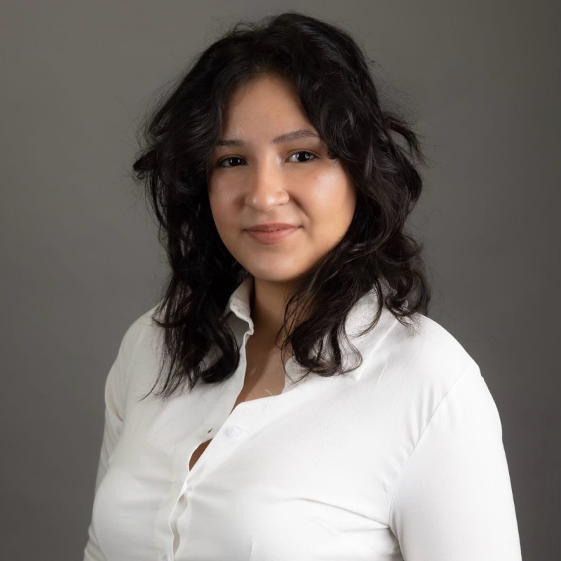
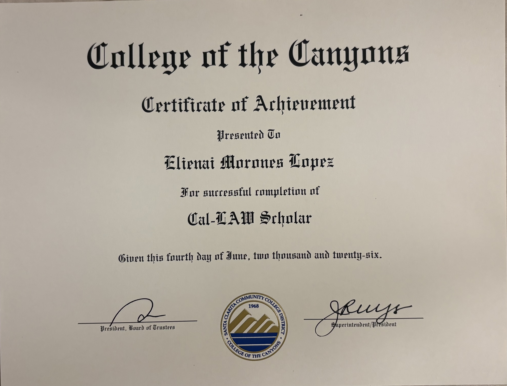
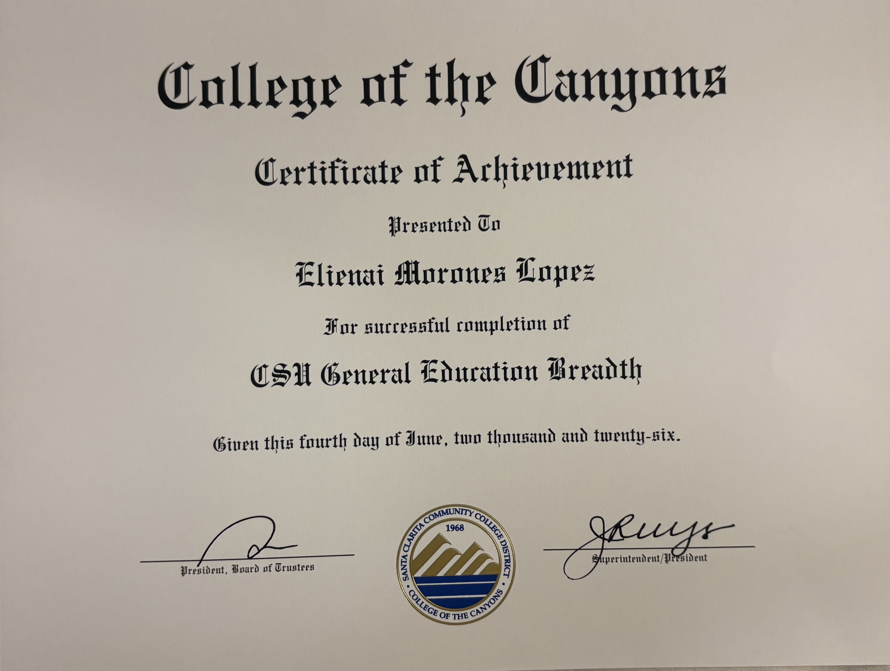
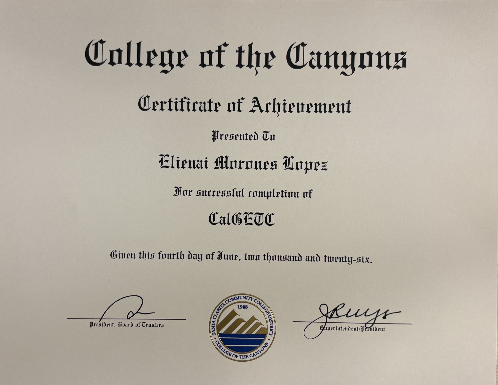
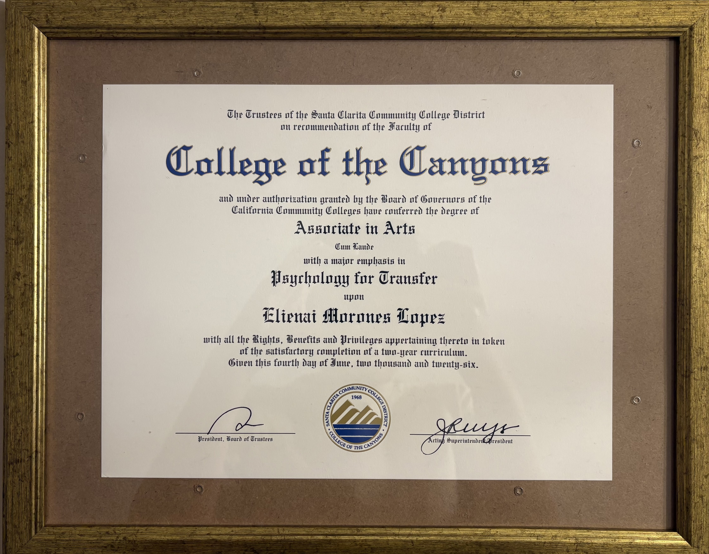
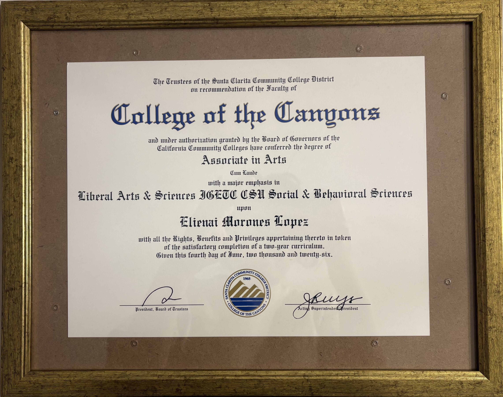
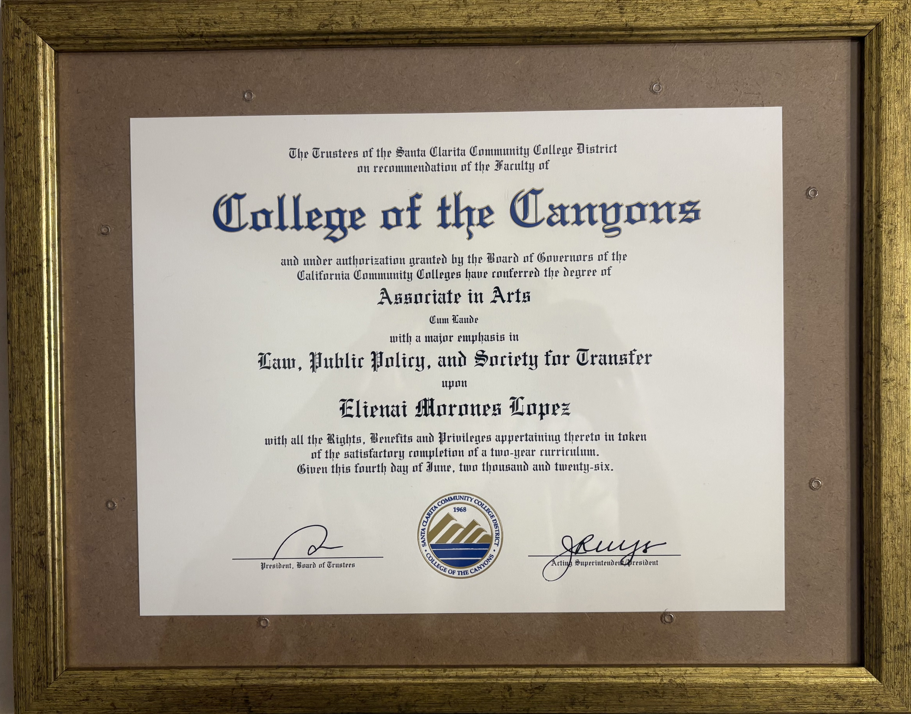

<html lang="en">

<head>
  <meta charset="UTF-8">
  <meta name="viewport" content="width=device-width, initial-scale=1, shrink-to-fit=no">

  <!-- Website favicon -->
  <link rel="shortcut icon" href="img/website.ico">

  <!-- Website information -->
  <meta name="description" content="Elienai Morones Lopez is a Political Science and Public Service student at UC Riverside with experience in legal services, criminal defense, immigration, nonprofit legal work, and customer service.">
  <meta name="author" content="emoro006">

  <title>Elienai Morones Lopez | Political Science & Public Service</title>

  <!-- Bootstrap core CSS -->
  <link href="vendor/bootstrap/css/bootstrap.min.css" rel="stylesheet">

  <!-- Custom fonts -->
  <link href="https://fonts.googleapis.com/css?family=Saira+Extra+Condensed:500,700" rel="stylesheet">
  <link href="https://fonts.googleapis.com/css?family=Muli:400,400i,800,800i" rel="stylesheet">
  <link href="vendor/fontawesome-free/css/all.min.css" rel="stylesheet">

  <!-- Custom template CSS -->
  <link href="css/resume.min.css" rel="stylesheet">

  <!-- Portfolio image styling -->
  
</head>

<body id="page-top">

  <!-- NAVIGATION -->
  <nav class="navbar navbar-expand-lg navbar-dark bg-primary fixed-top" id="sideNav">

    <a class="navbar-brand js-scroll-trigger" href="#page-top">

      Elienai Morones Lopez

      
        
      

    </a>

    <button
      class="navbar-toggler"
      type="button"
      data-toggle="collapse"
      data-target="#navbarSupportedContent"
      aria-controls="navbarSupportedContent"
      aria-expanded="false"
      aria-label="Toggle navigation">

      

    </button>

    

      <ul class="navbar-nav">

        <li class="nav-item">
          <a class="nav-link js-scroll-trigger" href="#about">About</a>
        </li>

        <li class="nav-item">
          <a class="nav-link js-scroll-trigger" href="#experience">Experience</a>
        </li>

        <li class="nav-item">
          <a class="nav-link js-scroll-trigger" href="#education">Education</a>
        </li>

        <li class="nav-item">
          <a class="nav-link js-scroll-trigger" href="#portfolio">Portfolio</a>
        </li>

      </ul>

    

  </nav>

  

    <!-- ABOUT -->
    <section
      class="resume-section p-3 p-lg-5 d-flex align-items-center"
      id="about">

      

        <h1 class="mb-3">
          Elienai Morones Lopez
        </h1>

        

          Political Science, Public Service 📚
        

        

          I am a Political Science, Public Service student at the University of California, Riverside with a strong interest in law, public service, psychology, public policy, and the legal system. My academic and professional experiences have allowed me to develop a broad understanding of how legal professionals, government institutions, and community organizations serve individuals and communities.

            

          Before transferring to UC Riverside, I attended College of the Canyons, where I completed coursework in psychology, social and behavioral science, and law, public policy, and society. I also completed legal and career-focused certificates that strengthened my understanding of the legal profession and introduced me to legal technology. These experiences helped me develop an interest in the relationship between law, public policy, and the people affected by legal decisions.

            

          My professional background includes experience in criminal defense, immigration services, civil litigation, and nonprofit legal work. Through these positions, I have worked directly with clients, attorneys, and legal professionals while assisting with case preparation, client communication, scheduling, documentation, filing, and administrative responsibilities. These experiences have taught me the importance of professionalism, confidentiality, organization, attention to detail, and clear communication in a legal environment.

            

          I have also gained experience supporting Spanish-speaking clients and communicating in both English and Spanish. Working with clients from different backgrounds has strengthened my ability to communicate information clearly, listen carefully, and approach each interaction with patience and professionalism. I value the opportunity to help people navigate processes that can sometimes feel complicated or unfamiliar.

            

          In addition to my legal experience, I currently work as a barista at The Coffee Bean & Tea Leaf. Working in customer service has strengthened skills that are valuable in any professional environment, including communication, teamwork, time management, problem solving, and the ability to remain organized in a fast-paced setting. Balancing employment with university coursework has also strengthened my independence and ability to manage competing responsibilities.

            

          At UC Riverside, I am continuing to build my academic foundation in political science and public service while exploring my long-term interest in law. I am particularly interested in how public policy and the legal system affect individuals and communities, as well as how legal professionals can use their knowledge and skills to advocate for others and contribute to public service.

            

          My long-term goal is to pursue a career in law and public service. I hope to continue developing my legal knowledge, communication skills, leadership abilities, and understanding of public policy as I prepare for graduate and law school opportunities. I am committed to using my education and professional experiences to build a career centered on service, advocacy, and making a meaningful contribution to the communities I serve.

        

        <!-- SOCIAL LINKS -->
        

          <a
            target="_blank"
            rel="noopener noreferrer"
            id="socialicon-1"
            href="https://www.linkedin.com/in/elienai-morones-lopez-140a7318a"
            aria-label="LinkedIn">

            <i class="fab fa-linkedin-in"></i>

          </a>

          <a
            target="_blank"
            rel="noopener noreferrer"
            id="socialicon-2"
            href="https://github.com/emoro006"
            aria-label="GitHub">

            <i class="fab fa-github"></i>

          </a>

          <a
            target="_blank"
            rel="noopener noreferrer"
            id="socialicon-3"
            href="https://www.ucr.edu/"
            aria-label="UC Riverside">

            <i class="fas fa-university"></i>

          </a>

          <a
            id="socialicon-4"
            href="mailto:emoro006@ucr.edu"
            aria-label="Email">

            <i class="fa fa-envelope"></i>

          </a>

        

      

    </section>

    

    <!-- EXPERIENCE -->
    <section
      class="resume-section p-3 p-lg-5 d-flex justify-content-center"
      id="experience">

      

        <h2 class="mb-5">Experience</h2>

        <!-- Criminal Defense -->
        

          

            <h3 class="mb-0">
              Criminal Defense Intake
            </h3>

            

              Law Offices of Sheida Shoalehvar
            

            

              • Conducted client intake interviews and gathered case information for attorneys 
              • Scheduled consultations and managed attorney calendars 
              • Maintained digital client files and ensured confidentiality compliance 
              • Communicated with clients via phone and email regarding case updates 
              • Entered and managed client data within case management systems 
              • Provided administrative support in a fast-paced legal environment
            

          

          

            
              August 2024 - December 2024
            
          

        

        <!-- Coffee Bean -->
        

          

            <h3 class="mb-0">
              Barista
            </h3>

            

              The Coffee Bean & Tea Leaf
            

            

              • Prepared coffee, tea, and specialty beverages while maintaining consistent quality 
              • Provided friendly and efficient customer service in a fast-paced environment 
              • Operated point-of-sale systems and processed customer transactions 
              • Maintained cleanliness, organization, and food-service standards 
              • Assisted with inventory, restocking, and daily store operations
            

          

          

            
              April 2026 - Present
            
          

        

        <!-- Immigration Services -->
        

          

            <h3 class="mb-0">
              Legal Secretary
            </h3>

            

              Immigration Services
            

            

              • Managed appointments, payments, and client documentation 
              • Prepared and organized immigration case files 
              • Provided bilingual Spanish-English support to clients 
              • Assisted with document translations and notarial services 
              • Maintained filing systems and client databases
            

          

          

            
              April 2024 - July 2024
            
          

        

        <!-- Quill & Arrow -->
        

          

            <h3 class="mb-0">
              Paralegal Intern
            </h3>

            

              Quill & Arrow LLP
            

            

              • Reviewed court dockets and case updates 
              • Prepared and filed legal documents 
              • Assisted attorneys with drafting and case preparation 
              • Organized and maintained case files 
              • Developed strong attention to detail and deadline management skills
            

          

          

            
              March 2024 - April 2024
            
          

        

        <!-- California Innocence Project -->
        

          

            <h3 class="mb-0">
              Legal Intern
            </h3>

            

              California Innocence Project
            

            

              • Assisted with initial screening of innocence claims 
              • Conducted client correspondence 
              • Provided Spanish translation assistance 
              • Supported administrative operations in a nonprofit legal clinic
            

          

          

            
              June 2022 - August 2022
            
          

        

      

    </section>

    

    <!-- EDUCATION -->
    <section
      class="resume-section p-3 p-lg-5 d-flex align-items-center"
      id="education">

      

        <h2 class="mb-5">Education</h2>

        <!-- UC Riverside -->
        

          

            <h3 class="mb-0">
              University of California, Riverside
            </h3>

            

              Bachelor of Arts
            

            

              Political Science, Public Service
            

          

          

            
              September 2026 - Expected June 2028
            
          

        

        <!-- College of the Canyons -->
        

          

            <h3 class="mb-0">
              College of the Canyons
            </h3>

            

              Associate Degrees & Certificates
            

            

              Psychology AA-T 
              Social & Behavioral Science AA 
              Law, Public Policy and Society AA 
              Cal-LAW Scholar Certificate 
              Legal Technology Certificate
            

          

          

            
              June 2023 - June 2026
            
          

        

      

    </section>

    

    <!-- PORTFOLIO -->
    <section
      class="resume-section p-1 p-lg-5 d-flex align-items-center"
      id="portfolio">

      

        <h2 class="mb-5">
          Portfolio
        </h2>

        

          

          

          

          

          

          

        

      

    </section>

    

    <!-- COPYRIGHT -->
    <footer class="text-center">

      &copy;

      

      Elienai Morones Lopez

    </footer>

     

  

  <!-- Bootstrap core JavaScript -->
  
  

  <!-- Plugin JavaScript -->
  

  <!-- Custom scripts -->
  

</body>

</html>
